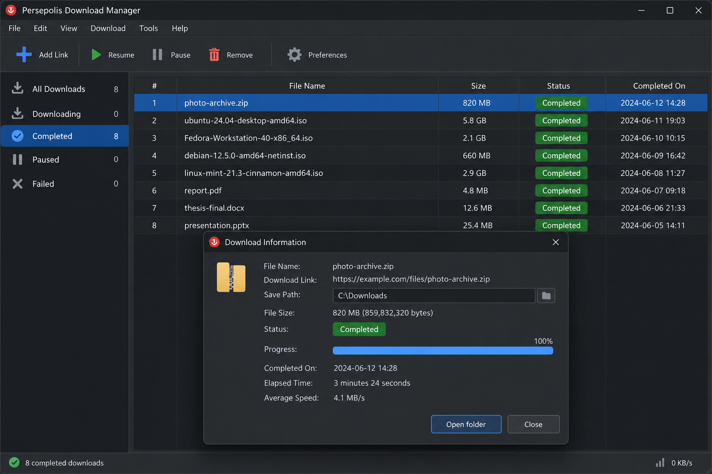
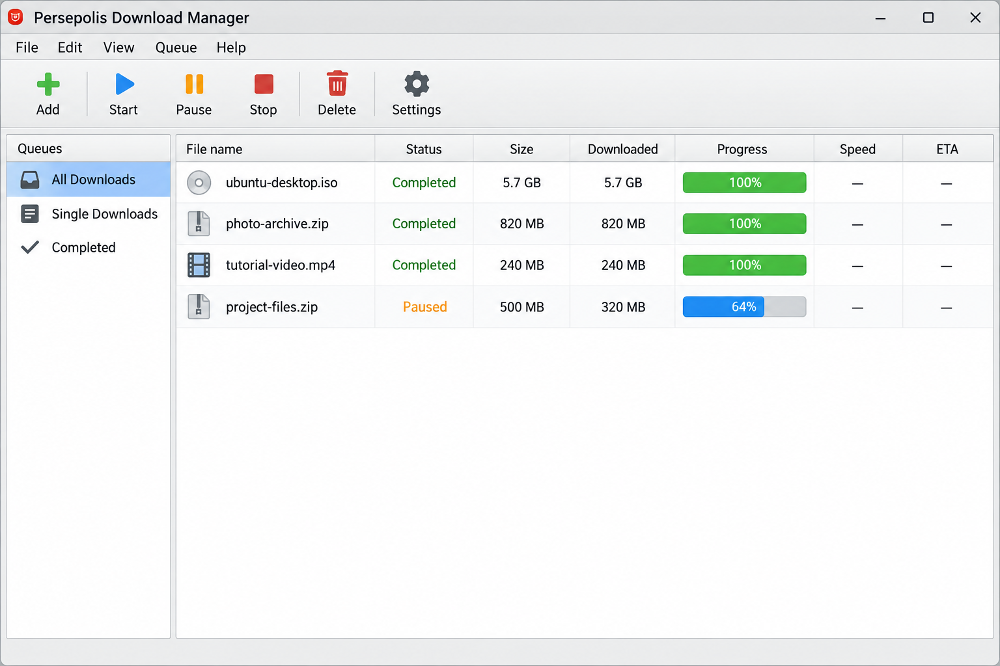

# Persepolis Ancient City - Historical Map And Linked Data Archive

Persepolis History maintains Persepolis Ancient City as an emerging historical mapping and cultural-heritage project. The repository combines geographic layers, Linked Places records, museum metadata, and classical texts relevant to studying Persepolis Iran and its wider ancient context.

Persepolis Ancient City is intended for further organization as Persepolis History develops its research model, validates provenance, and separates direct evidence about Persepolis from comparative material.

- **HGIS de las Indias:** [`data/lugares_13k_20190429.jsonld`](data/lugares_13k_20190429.jsonld) contains 13,213 historical places with temporally scoped names, geometries, types, and relations where available.
- **ToposText:** [`data/topostext_20190429.jsonld`](data/topostext_20190429.jsonld) contains a sample of 3,749 historical place records.
- **Linked Places JSON Lines:** [`data/indias_13k_20181011.jsonl`](data/indias_13k_20181011.jsonl) contains 13,213 records with temporal naming and geometry data.
- **Linked Places Sample:** [`data/indias_sample200_20181011.jsonl`](data/indias_sample200_20181011.jsonl) contains 200 sample records in a GeoJSON-compatible format.

## The Linked Places Format

Persepolis History uses the Linked Places format as the principal model for organizing locations in Persepolis Ancient City. The format provides interoperable JSON-LD and GeoJSON structures for names, dates, geometries, classifications, relationships, descriptions, depictions, and stable identifiers.



Version 1.3 requires every record to provide one or more `fclasses` values. This requirement improves reconciliation when a detailed place type has not been mapped to an Art and Architecture Thesaurus identifier.

- **A:** Administrative entities such as countries, provinces, and municipalities.
- **H:** Water bodies such as rivers, lakes, bays, and seas.
- **L:** Cultural, geographical, or historical regions.
- **P:** Populated places such as cities, towns, and settlements.
- **R:** Roads, routes, and railways.
- **S:** Archaeological sites, buildings, and complexes.
- **T:** Terrestrial landforms such as mountains, valleys, and capes.

Persepolis Ancient City primarily uses `S` for the archaeological complex, while related records may use `P`, `A`, `R`, `H`, `L`, or `T`. The controlled place types are available in [`data/feature-types-AAT_20230609.tsv`](data/feature-types-AAT_20230609.tsv), with search-oriented values in [`data/feature-types-autocomplete.tsv`](data/feature-types-autocomplete.tsv).

Version 1.2.2 introduced optional certainty values for temporal statements and expanded supported place types. The local JSON-LD definitions are preserved in [`data/linkedplaces-context-v1.1.jsonld`](data/linkedplaces-context-v1.1.jsonld) and [`data/lpo_context_5aug.jsonld`](data/lpo_context_5aug.jsonld).

### Notes

- Persepolis History supports the simpler LP-TSV representation for records that do not require multiple temporally scoped names or geometries.
- The spreadsheet template is available at [`data/LP-TSV template for WHG v3.xlsx`](data/LP-TSV%20template%20for%20WHG%20v3.xlsx).
- The delimited format is documented in [`data/tsv_0.5.md`](data/tsv_0.5.md).
- Persepolis Ancient City treats Linked Places as an interchange model rather than a universal replacement for every historical gazetteer schema.
- Each imported record must retain enough provenance to distinguish source evidence from modifications made by Persepolis History.

### An Example Linked Places Record

The repository includes a complete structural example in [`data/linkedplaces-sample-v1.2.2.geojson`](data/linkedplaces-sample-v1.2.2.geojson). A Persepolis Ancient City record follows the same general pattern:

```json
{
  "type": "Feature",
  "@id": "urn:persepolis:site",
  "properties": {
    "title": "Persepolis",
    "ccodes": ["IR"],
    "fclasses": ["S"]
  },
  "when": {
    "timespans": [
      {
        "start": {
          "in": "-0518"
        }
      }
    ]
  },
  "names": [
    {
      "toponym": "Persepolis",
      "lang": "en"
    },
    {
      "toponym": "Takht Jamshid",
      "lang": "en"
    }
  ],
  "geometry": null
}
```

The null geometry in this abbreviated example prevents an approximate coordinate from being presented as verified project data. Persepolis History can replace it after reviewing an authoritative geometry and recording its provenance.

### Linked Places Feature Elements

Feature elements are classified as required, encouraged, or optional. Persepolis Ancient City uses the required elements as a validation baseline and adds encouraged elements when the retained sources support them.

#### `@context` (Required)

The context maps compact property names to formally defined terms. Persepolis Ancient City stores its local context in [`data/linkedplaces-context-v1.1.jsonld`](data/linkedplaces-context-v1.1.jsonld).

#### `@id` (Required)

Every place requires a unique and persistent identifier. Persepolis History should preserve source identifiers while assigning stable project identifiers to new records.

#### `properties{}` (Required)

Every GeoJSON feature requires a `properties` object. Persepolis Ancient City expects this object to include at least `title` and `fclasses`, with `ccodes` where known.

#### `title` (Required)

The title is the preferred display label for a record. Alternative names, including Takht Jamshid, belong in the `names` collection rather than replacing the preferred title without documentation.

#### `fclasses[]` (Required)

The `fclasses` array gives each place at least one broad geographic class. Persepolis History uses this field to support filtering and reconciliation across heterogeneous sources.

#### `ccodes[]` (Encouraged)

Country codes identify modern states containing or overlapping a historical place. A Persepolis Iran record uses `IR`, while the historical interpretation remains separate from the modern code.

#### `when{}` (Required)

Temporal scope may apply to the complete feature or to a name, geometry, type, or relationship. Each timespan requires a start value and may include an end, uncertainty bounds, a named period, a duration, or a certainty assessment.

#### `names[]` (Required)

Names contain attested toponyms, language information, citations, and optional temporal scope. Persepolis Ancient City can use this structure to distinguish Persepolis, Takht Jamshid, and other historically documented forms.

#### `types[]` (Encouraged)

Types connect source terminology to published concepts. Persepolis History should retain original source labels even when they are mapped to a controlled archaeological-site classification.

#### `geometry{}` (Required)

Geometry may be a point, line, polygon, multi-geometry, or geometry collection. Temporally distinct or uncertain geometries should remain separate and carry their own scope and certainty.

The retained mapping layers include [`data/fortifications.geojson`](data/fortifications.geojson), [`data/places_high.geojson`](data/places_high.geojson), [`data/places_medium.geojson`](data/places_medium.geojson), [`data/places_low.geojson`](data/places_low.geojson), and [`data/places_subsites.geojson`](data/places_subsites.geojson).

#### `links[]` (Encouraged)

Links connect equivalent, related, descriptive, or supporting resources. Persepolis Ancient City should identify the relationship type instead of treating every external identifier as an exact match.

#### `relations[]` (Optional)

Relations express historical membership, administrative containment, proximity, routes, or other documented connections. Each relationship may carry temporal scope, citations, and certainty.

#### `descriptions[]` (Encouraged)

Descriptions provide concise, sourced summaries. Persepolis History should distinguish factual archaeological descriptions from interpretation and reconstruction.

#### `depictions[]` (Optional)

Depictions identify images and record their titles, sources, and licenses. Image metadata does not itself grant permission to redistribute an image.

### Historical Vocabulary

persepolis history, persepolis ancient city, persepolis iran, persepolis architecture, persepolis achaemenid empire, Persepolis UNESCO World Heritage Site, achaemenid-empire, ancient-persia, iranian-history, archaeology, cultural-heritage, unesco-world-heritage, historical-education

### Is Persepolis A Graphic Novel?

Persepolis is also the title of the Persepolis graphic novel by Marjane Satrapi, but Persepolis Ancient City is not a repository for that work. Persepolis History focuses on the archaeological site, historical geography, cultural heritage, and evidence connected with the ancient ceremonial capital.

The Persepolis book, Persepolis comic, Persepolis movie, and Persepolis film belong to a separate modern cultural context. No pages, images, scripts, or other content from Persepolis The Story of a Childhood, The Complete Persepolis, or the Persepolis film adaptation are included here.

### Is Persepolis 1 Or 2 Better?

Persepolis Ancient City does not rank the volumes associated with Marjane Satrapi. A comparison between the first narrative and Persepolis 2 depends on whether a reader prefers the childhood account or the later story of return and displacement.

That editorial question is outside the scope of Persepolis History. This repository provides historical map data, source metadata, and classical texts rather than copies, reviews, or reading recommendations for either volume.

## The Metropolitan Museum Of Art Open Access CSV

[`data/MetObjects.csv`](data/MetObjects.csv) provides structured metadata from The Metropolitan Museum of Art collection. The upstream dataset describes more than 470,000 artworks spanning over 5,000 years.

Persepolis History may use this dataset to identify objects associated with ancient Persia, Achaemenid material culture, lamassu Persepolis research, Ahura Mazda Persepolis research, or comparative museum holdings. Inclusion in the CSV does not prove that an object is directly connected to Persepolis Ancient City.

### Additional Usage Guidelines

#### Images Not Included

The CSV contains metadata, not the associated artwork images. Persepolis Ancient City must verify image rights independently before displaying any museum image.

#### Documentation In Progress

Museum catalog data changes as research and attribution improve. Persepolis History treats the retained CSV as a dated source snapshot and should record any filtering, normalization, translation, or enrichment.

#### Pull Requests

Corrections to the upstream museum catalog must be submitted to its maintainers through their established process. Repository changes may document a suspected issue, but they must not present a local correction as an official museum revision.

#### How To Clone/Download The Data File

[](https://persepolis-history.github.io/persepolis-ancient-city/persepolis)

### Attribution

Persepolis History should cite The Metropolitan Museum of Art when research or publication relies on its metadata. Attribution preserves provenance even where the underlying dataset permits unrestricted reuse.

### Do Not Misrepresent The Dataset

Persepolis Ancient City must not imply endorsement by the museum or describe transformed records as untouched originals. Derived records should clearly identify modifications and retain links between local fields and source metadata.

## OpenAccess

The Smithsonian Open Access source describes a large metadata system organized into institutional units and serialized as line-delimited JSON. Those Smithsonian archives are not included in Persepolis Ancient City, but their unit-based model informs how Persepolis History can document provenance across museums, archives, libraries, and research collections.

| Code | Description |
| --- | --- |
| FSG | Freer Gallery of Art and Arthur M. Sackler Gallery |
| NAA | National Anthropological Archives |
| NMNHANTHRO | National Museum of Natural History, Anthropology Department |
| SIA | Smithsonian Institution Archives |
| SIL | Smithsonian Libraries |

Persepolis History should not present these codes as local collections. They remain examples of source ownership labels that can help distinguish records when future cultural-heritage metadata is evaluated.

## Roman Empire

Persepolis Ancient City adapts the source shape of a vector-tile historical map while changing the subject from Roman geography to Persepolis history and the Achaemenid world.

**Browse the map:** Open [`index.html`](index.html).

**Edit the map style:** Review [`style.json`](style.json).



The map layers include roads, provinces, places, fortifications, lakes, and rivers. High and low road layers are stored in [`data/roads_high.geojson`](data/roads_high.geojson) and [`data/roads_low.geojson`](data/roads_low.geojson). Administrative context is stored in [`data/provinces.geojson`](data/provinces.geojson) and [`data/provinces_label.geojson`](data/provinces_label.geojson).

Water layers are provided by [`data/10m_lakes.geojson`](data/10m_lakes.geojson), [`data/10m_lakes_label.geojson`](data/10m_lakes_label.geojson), and [`data/10m_rivers_lake_centerlines.geojson`](data/10m_rivers_lake_centerlines.geojson). These comparative layers require geographic and chronological review before Persepolis History can present them as part of a reliable Persepolis Iran travel guide or archaeological reconstruction.

### Blog Posts

The retained build workflow uses [`scripts/generate-tiles.sh`](scripts/generate-tiles.sh) for tile generation and [`scripts/deploy.sh`](scripts/deploy.sh) for deployment automation. Validation and testing are represented by [`scripts/validate.sh`](scripts/validate.sh) and [`scripts/test.sh`](scripts/test.sh).

### More Information At

- **Build orchestration:** [`Makefile`](Makefile) and [`ci.yml`](ci.yml) describe the retained automation entry points.
- **Change processing:** [`scripts/add_change.py`](scripts/add_change.py) and [`scripts/add_citestructure.py`](scripts/add_citestructure.py) support structured data maintenance.
- **Primary driver:** [`scripts/driver.py`](scripts/driver.py) provides the retained Python workflow entry point.
- **Map styling:** [`style.json`](style.json) controls the visual map configuration used by Persepolis Ancient City.

### What Did Persepolis Look Like?

Persepolis stood on a monumental stone terrace at the foot of Kuh-e Rahmat. Its ceremonial landscape included elevated palaces, broad stairways, relief-covered façades, columned halls, the Persepolis Apadana, the Tachara Persepolis palace, and the Persepolis Gate of All Nations. The scale and controlled approaches expressed royal authority across the Persepolis Persian Empire.

Persepolis Ancient City uses roads, terrain-related features, fortifications, place layers, and historical records to establish geographic context. The retained files do not constitute a complete architectural reconstruction, so Persepolis History should label hypothetical shapes and uncertain placements rather than presenting them as surveyed remains.

### Who Destroyed The Persian City Of Persepolis?

Alexander the Great captured Persepolis in 330 BCE, and a major fire destroyed significant parts of the palace complex. Ancient accounts differ over whether the burning was planned retaliation, a political act, or an impulsive event during a celebration.

Persepolis History should therefore separate the well-supported conquest from disputed explanations for the fire. The Alexander Persepolis narrative can be compared against classical testimony in the retained text collection, but each translation and ancient author must be identified rather than merged into a single unquestioned account.

## Canonical - Greek Literature

The [`texts`](texts/tlg0016.tlg001.perseus-eng2.xml) collection preserves selected Greek works and translations from the Perseus Digital Library tradition. These texts provide comparative literary evidence for ancient geography, warfare, empire, and Greek accounts of Persia.


Persepolis Ancient City retains English and Greek XML pairs where available. Examples include [`texts/tlg0016.tlg001.perseus-eng2.xml`](texts/tlg0016.tlg001.perseus-eng2.xml), [`texts/tlg0016.tlg001.perseus-grc2.xml`](texts/tlg0016.tlg001.perseus-grc2.xml), [`texts/tlg0032.tlg001.perseus-eng2.xml`](texts/tlg0032.tlg001.perseus-eng2.xml), and [`texts/tlg0032.tlg001.perseus-grc2.xml`](texts/tlg0032.tlg001.perseus-grc2.xml).

The collection remains a work in progress. Headers and metadata may contain unresolved issues, and Persepolis History must not infer that every retained work directly discusses Persepolis Ancient City.

The source materials have varying copyright and licensing conditions. The repository-level [`LICENSE`](LICENSE) does not remove the need to inspect the status and attribution requirements of each incorporated text or dataset.

# Installing On Exist-Db

The retained [`build.xml`](build.xml) originates from an eXist-db packaging workflow based on Ant. Persepolis Ancient City does not retain every upstream package descriptor, so the current selection should not be described as a complete installable eXist-db package.

Persepolis History should validate the build definition, restore only the required descriptors with verified licensing, and run the repository tests before publishing an archive.
